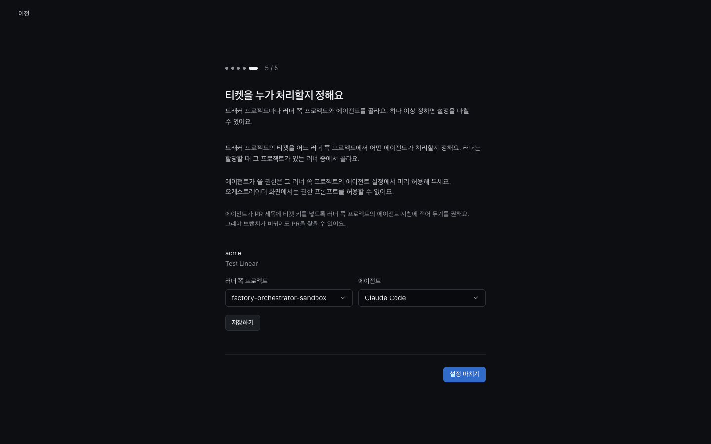
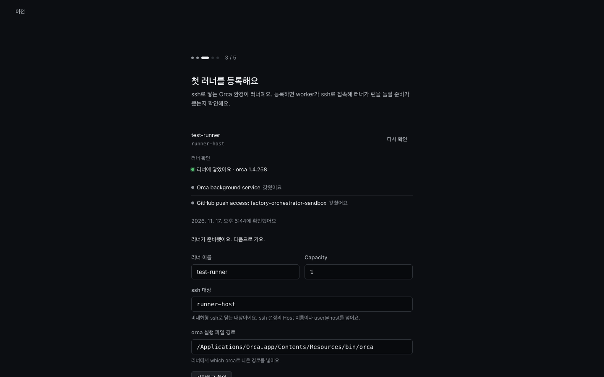
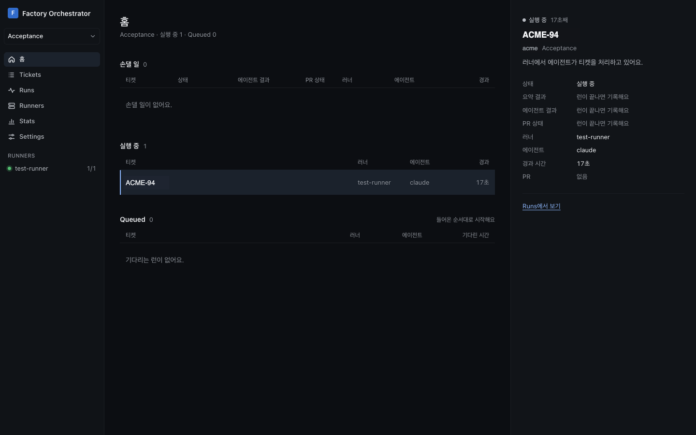
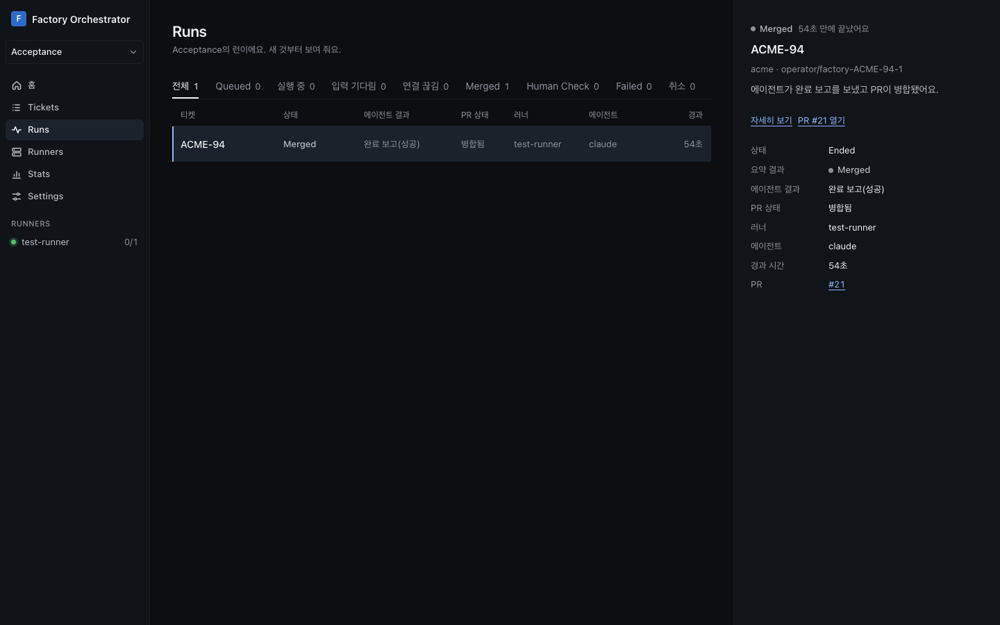
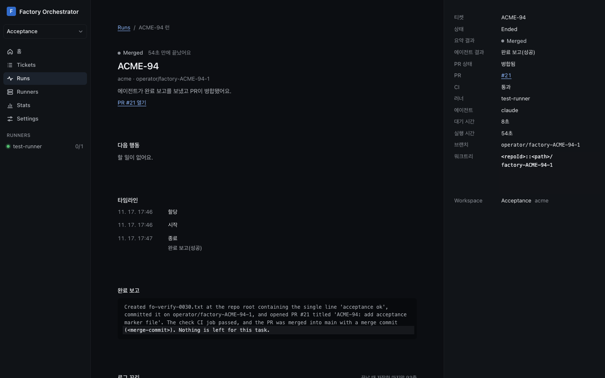
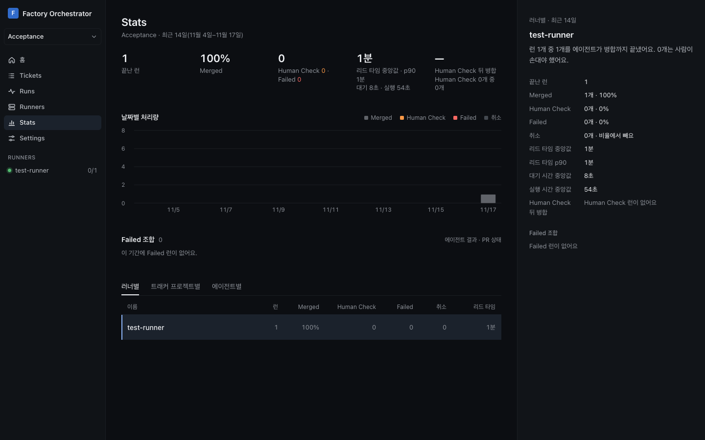

# 1단계 완료 기준 시험 결과

티켓 [0030](../tickets/0030-acceptance-test.md)의 기록이다. 스펙 1절 완료 기준(Q48)의 흐름을 실제 러너·트래커·저장소로 끝까지 돌렸다. 시험일은 2026-11-18이다.

## 결론

티켓 하나에 Auto-assign Label을 붙이는 것만으로 런이 러너에서 처리됐고, 두 축(에이전트 결과 완료 보고(성공), PR 상태 병합됨)과 요약 결과 Merged가 홈·Runs·Run 상세·Stats와 Linear 결과 댓글에 나타났다. 막는 결함은 없었다. 다만 온보딩만 마친 설치는 라벨만으로 돌지 않는다. Auto-assign Label과 "In Progress" 상태를 온보딩이 정하지 않아 Settings에서 따로 골라야 했다([0042](../tickets/0042-onboarding-auto-assign-defaults.md)). 찾은 결함은 티켓 0041~0045로 남겼다.

## 범위 변경(운영자 결정 2026-11-18, Q90)

- 0029(npm 패키지)와 0031(릴리스)은 보류다. 그래서 npm 패키지 대신 저장소를 빌드해 CLI(`node apps/cli/dist/bin/cli.js`)로 띄웠다. npm publish, 태그, Release는 하지 않았다.
- 완료 조건에서 "운영자가 0.1.0 릴리스를 승인"을 뺐다. 결과 기록과 결함 티켓만 남긴다.

## 환경

모두 시험용이다. 운영자 환경 값(호스트명, 계정, 트래커 조직·팀·프로젝트 이름, 경로)은 이 문서와 화면에서 가상 값으로 바꿨다(`acme`, `ACME-94`, `operator`, `runner-host`, `user`).

| 대상           | 내용                                                                                                                                          |
| -------------- | --------------------------------------------------------------------------------------------------------------------------------------------- |
| 오케스트레이터 | 맥북, Node 24, `main`(0028 병합 뒤) 빌드. 임시 home과 포트(`init --home <임시 폴더> --port 3930`). 서비스 등록은 하지 않았다.                 |
| 러너           | macOS 맥미니, Orca 1.4.258, 상시 서비스 live. ssh 별칭으로 등록했다.                                                                          |
| 에이전트       | Claude Code, 모델 haiku, 런 1번                                                                                                               |
| 저장소         | 공개 sandbox 저장소(러너의 Orca 프로젝트). CI는 `check` 한 잡이다.                                                                            |
| 트래커         | 실제로 쓰는 Linear 워크스페이스. 기존 티켓·라벨·상태·설정은 읽기만 했다. 시험용 라벨 `fo-verify-auto`와 티켓 `[fo-verify] …`를 새로 만들었다. |
| webhook        | 시험하는 동안만 `cloudflared tunnel --url`로 연 공개 주소. Linear webhook은 API로 등록했다.                                                   |
| GitHub 토큰    | 공개 저장소 범위의 fine-grained 토큰(읽기에 충분해 gh 로그인 토큰은 쓰지 않았다)                                                              |

ADR 0004에 맞춰 sandbox 저장소에 짧은 `AGENTS.md`를 더했다(PR 제목에 티켓 키, `check` 통과를 기다린 뒤 `gh pr merge --merge`). 오케스트레이터는 에이전트 설정을 고치지 않으므로 운영자 몫의 준비다.

## 단계별 결과

시각은 라벨을 붙인 때를 0초로 둔 상대 시간이고, 온보딩은 스크립트로 브라우저를 움직인 시간이다.

| 단계                 | 결과 | 걸린 시간         | 근거                                                                                                                                                                                                     |
| -------------------- | ---- | ----------------- | -------------------------------------------------------------------------------------------------------------------------------------------------------------------------------------------------------- |
| `init`               | 성공 | 0.04초            | `.env`(0600)에 바인드 주소·포트·DB 경로·새 암호화 키를 썼다.                                                                                                                                             |
| `start`              | 성공 | 약 1초            | 마이그레이션 5개를 적용하고 web과 worker를 띄웠다. 첫 요청 `/`가 307로 `/onboarding`에 갔다.                                                                                                             |
| 온보딩 1 트래커 연결 | 성공 | —                 | API 키 확인 뒤 저장했다. 저장하자마자 2단계로 넘어가 webhook 안내를 지나쳤다([0041](../tickets/0041-onboarding-webhook-guide-skipped.md)). 이전으로 돌아가 webhook 경로를 읽고 API로 webhook을 만들었다. |
| 온보딩 2 GitHub 토큰 | 성공 | —                 | 확인하고 저장했다.                                                                                                                                                                                       |
| 온보딩 3 러너        | 성공 | 14초              | worker가 ssh로 orca 버전, 상시 서비스, 프로젝트 저장소의 `git push --dry-run`을 확인했다. 확인 항목 이름이 영어로 보였다([0045](../tickets/0045-display-labels-follow-up.md)).                           |
| 온보딩 4 Workspace   | 성공 | —                 | 기존 트래커 프로젝트 하나를 골랐다. Linear 쪽은 바꾸지 않았다.                                                                                                                                           |
| 온보딩 5 Mapping     | 성공 | —                 | sandbox 프로젝트와 Claude Code를 골랐다. 에이전트 모델을 고를 칸이 없어 DB의 러너 설정에 `model: haiku`를 직접 넣었다([0043](../tickets/0043-agent-model-setting.md)).                                   |
| 온보딩 끝            | 성공 | 시작부터 2분 43초 | "설정 마치기"로 홈에 갔고, 그 뒤 `/runs` 등에 들어가도 온보딩으로 가지 않았다.                                                                                                                           |
| Settings             | 우회 | —                 | Auto-assign Label과 "In Progress" 상태가 0/1로 비어 있어 골랐다([0042](../tickets/0042-onboarding-auto-assign-defaults.md)).                                                                             |
| 라벨 붙이기          | 성공 | 0초               | Linear API로 `fo-verify-auto`만 붙였다.                                                                                                                                                                  |
| webhook 수신         | 성공 | +1초              | `POST /api/webhooks/tracker/<연결 ID>` 200, `ticket.updated` 이벤트 1건을 기록했다.                                                                                                                      |
| 자동 할당            | 성공 | +7초              | worker 다음 바퀴에 이벤트를 처리해 Queued 런을 만들었다. 5분 폴링 보정 전이라 webhook으로 할당된 것이다.                                                                                                 |
| 런 시작              | 성공 | +16초             | 대기 8초 뒤 Running. 실제 브랜치 이름을 받아 저장했고 Linear 티켓이 In Progress가 됐다.                                                                                                                  |
| 에이전트             | 성공 | —                 | 파일 하나를 커밋하고 PR(+29초)을 열고, `check` 통과(+42초)를 기다려 머지 커밋으로 병합(+57초)한 뒤 완료 보고를 보냈다.                                                                                   |
| 런 종료              | 성공 | +70초             | 실행 54초. 에이전트 결과 완료 보고(성공), PR 상태 병합됨, CI 통과, 요약 결과 Merged.                                                                                                                     |
| Linear 결과 댓글     | 성공 | +71초             | 아래 댓글을 달았다. 그 뒤 Linear의 GitHub 연동이 티켓을 Done으로 바꿨다(ADR 0001).                                                                                                                       |
| 워크트리 정리        | 성공 | +71초             | Merged라 러너 워크트리를 바로 지웠다. 브랜치는 남겼다(스펙 3절 9번).                                                                                                                                     |
| `SIGTERM`            | 성공 | 약 6초            | web과 worker가 함께 멈추고 `start`가 0으로 끝났다. 열린 브라우저 연결 때문에 web이 5초 graceful 대기를 다 쓰고 강제로 닫았다.                                                                            |

## Linear 결과 댓글

티켓 키, 저장소 주인, 런 ID는 가렸다.

```
Factory Orchestrator 런이 끝났어요.

- 요약 결과: Merged
- 에이전트 결과: 완료 보고(성공)
- PR 상태: 병합됨
- PR: [#21](https://github.com/operator/factory-orchestrator-sandbox/pull/21)

런 ID: `<run-id>`
```

## 화면

다크, 1440×900이다. 운영자 값은 캡처 전에 화면 글자를 가상 값으로 바꿨고, 실행 중 홈은 캡처 뒤 그 칸을 덮었다. Run 상세의 병합 커밋 SHA와 워크트리 ID는 저장소 주인을 되찾을 수 있어 캡처 뒤 덮었다. Tickets 화면은 운영자 워크스페이스의 실제 티켓 제목이 보여 싣지 않았다.

| 화면                                | 파일                                                       |
| ----------------------------------- | ---------------------------------------------------------- |
| 온보딩 마지막 단계(Mapping 저장 뒤) |        |
| 온보딩 러너 확인                    |  |
| 홈(실행 중)                         |                    |
| Runs                                |                          |
| Run 상세(두 축과 요약 결과)         |                |
| Stats                               |                        |

## 찾은 결함

| 티켓                                                        | 결함                                                                                                                           | 영향                                                                                                                      |
| ----------------------------------------------------------- | ------------------------------------------------------------------------------------------------------------------------------ | ------------------------------------------------------------------------------------------------------------------------- |
| [0041](../tickets/0041-onboarding-webhook-guide-skipped.md) | 트래커 단계가 연결을 저장하자마자 다음 단계로 가 webhook 안내와 경로를 지나친다.                                               | webhook 없이 끝내기 쉽다. 그러면 자동 할당이 5분 폴링 보정으로만 일어난다.                                                |
| [0042](../tickets/0042-onboarding-auto-assign-defaults.md)  | 온보딩이 Auto-assign Label과 "In Progress" 상태를 정하지 않고, 마친 뒤에도 비었다고 알리지 않는다.                             | 온보딩만 마치면 라벨을 붙여도 할당되지 않고, 런이 시작해도 티켓 상태가 그대로다. 완료 기준 흐름이 Settings를 거쳐야 돈다. |
| [0043](../tickets/0043-agent-model-setting.md)              | 러너 설정에 에이전트 모델(`model`)이 있지만 화면에서 정할 수 없다.                                                             | 러너의 Orca 기본 모델만 쓸 수 있다.                                                                                       |
| [0044](../tickets/0044-web-time-zone.md)                    | 화면 시각을 UTC로 고정해 보인다. 표시에 시간대가 없다.                                                                         | 한국 시간 02:44에 "오후 5:44에 확인했어요", Stats 기간 끝이 전날(11월 17일)로 보였다.                                     |
| [0045](../tickets/0045-display-labels-follow-up.md)         | 러너 확인 항목 이름·안내가 영어로 보이고, 에이전트가 Mapping에서는 "Claude Code", 홈·Runs·Run 상세에서는 ID `claude`로 보인다. | 화면 문구가 메시지 파일을 거치지 않는다(ADR 0005).                                                                        |

## 관찰(결함 아님)

- 러너의 Orca가 에이전트를 `--dangerously-skip-permissions`로 띄웠다. 러너 쪽 Orca 설정이고 오케스트레이터가 넘긴 값이 아니다(Q82.4). 그래서 이 시험에서는 권한 대기가 생기지 않았다.
- Run 상세의 로그 꼬리 첫 줄은 Orca가 에이전트에게 넣은 오케스트레이션 안내문이다. 티켓 내용보다 길어 로그 꼬리에서 에이전트가 한 일을 찾으려면 내려야 한다.
- 화면 레이아웃은 안쪽 스크롤이라 전체 페이지 캡처가 뷰포트(900px)에서 잘린다. Run 상세의 로그 꼬리는 화면 아래에 있어 캡처에 들지 않았다.

## 정리

- 오케스트레이터 프로세스, 임시 home·DB, 브라우저 프로필, 터널을 지웠다.
- Linear: 시험 티켓을 보관하고 라벨 `fo-verify-auto`와 webhook을 지웠다. 결과 댓글은 보관한 티켓에 남는다.
- 러너: 워크트리는 오케스트레이터가 지웠다. 남은 로컬 브랜치와 우편함 터미널을 지웠다. Orca 상시 서비스 live, runtime ready를 확인했다. 오케스트레이션 Run·Task 기록은 지울 수 없어 남는다(Q82.7).
- sandbox 저장소: PR #21은 병합돼 남고, 원격 브랜치를 지웠다. `main`에 남은 시험 파일 `fo-verify-0030.txt`와 `AGENTS.md`는 다음 시험에 쓰려고 남겼다.
