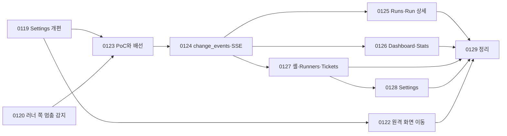

# 웹 Query 캐시와 변경 기록 스펙

웹 화면의 데이터 읽기를 TanStack Query로 옮기고, 서버에서 바뀐 것을 열린 화면에 알리는 기준 문서다. 조사(research [0015](../research/0015-tanstack-query.md) TanStack Query, [0016](../research/0016-web-data-loading.md) 지금 데이터 읽기)와 2026-11-19 운영자 결정 C1~C14, 그리고 이 문서와 함께 쓴 ADR [0019](../adr/0019-query-cache-and-change-events.md)를 한곳에 묶는다. C1~C14는 이 문서에 처음 모아 적는 결정이고 11절에 운영자가 정한 문장 그대로 두었다. 본문의 해당 문장이 그 결정이다. 이 문서는 새 결정을 만들지 않는다. 근거 문서에 없는 것은 「열린 질문」에 남긴다.

용어는 [GLOSSARY](../../GLOSSARY.md)를 따른다. 이 문서를 쪼갠 티켓은 [0123](../tickets/0123-query-poc.md)~[0129](../tickets/0129-query-cleanup.md)이다. 원격에서 화면 이동을 빠르게 하는 서버 쪽 일은 티켓 0122가 맡는다(C8).

## 1. 목표와 완료 기준

목표: 운영자가 다른 기기에서 사설망 너머로(왕복 20~200ms) 쓸 때도 화면 이동이 왕복을 덜 기다리고, 열린 화면이 worker·트래커 webhook·MCP·다른 기기가 바꾼 것을 몇 초 안에 보인다. 쓰기 하나가 화면 전체와 트래커를 다시 읽게 하지 않는다.

완료 기준(C13):

- hydration 직후 클라이언트가 같은 query를 다시 읽지 않는다.
- mutation 하나는 그 mutation이 바꾼 query만 다시 읽는다. 루트와 셸은 다시 읽지 않는다.
- worker가 바꾼 런 상태가 열린 화면(Dashboard, Runs, Run 상세)에 3초 안에 보인다.
- SSE가 끊기면 열린 화면이 30초마다 다시 읽는다.
- 0117의 화면 이동 브라우저 시험(`e2e/src/navigation.test.ts`)이 그대로 통과한다.
- 0117 측정과 원격 지연 측정(0122)을 다시 돌려 전·후 표를 남긴다(0129).

## 2. 범위와 제외

범위:

- **Query로 옮기는 것(C1).** `_app` 데이터 화면(Dashboard, Tickets, Runs, Run 상세, Runners, Stats, Settings)과 셸(레일 배지, Workspace 목록).
- **라우터 로더로 두는 것(C1).** 루트(시간대·제목 표시줄 쿠키, 온보딩 완료 확인), 온보딩, 러너 설정 흐름.
- **변경 기록과 SSE(C9, C10).** DB 표 `change_events`, 새 통로 `/api/change-events/stream`, 웹의 구독과 key 무효화, 폴링 대비.

제외:

- **서버 쪽 트래커 캐시와 화면 이동 왕복 줄이기, 누른 표시(C8).** 티켓 0122가 한다. 이 문서의 Linear query(C3)는 브라우저 쪽 캐시이고, 0122의 서버 캐시와 겹쳐 쓴다.
- **DB를 혼자 여는 서버 프로세스(C9).** 이번에 하지 않는다. 이유는 ADR 0019.
- **알림 사건 SSE 바꾸기(C10).** `/api/notification-events/stream`과 데스크톱 앱 구독은 그대로다.
- **모바일 `/api/v1`.** 모바일 앱은 웹 화면을 쓰지 않아(스펙 0002 M1) 이 캐시와 상관없다.

## 3. 선행과 순서

- 0118(런 멈추기·재개), 0115(Mapping 저장소 여럿), 0119(Settings 개편)는 `develop`에 머지됐다. 0120(러너 쪽 멈춤 감지)이 머지된 뒤 Query 작업을 시작한다(C8). 0120이 런 상태를 쓰는 worker 코드를 바꾸기 때문이다.
- 0129는 0122의 원격 지연 측정 스크립트로 다시 재므로 0122 뒤에 한다.
- 0122는 0127·0128과 같은 로더 파일(`packages/app/src/tickets/load.ts`, `packages/app/src/settings/load.ts`)을 고친다. 0127·0128은 0123·0124 뒤라 0122가 먼저 머지될 가능성이 크고, 그러면 0122의 서버 캐시 위에서 서버 함수를 나눈다. 함께 돌면 늦게 머지하는 쪽이 맞춘다.
- 순서(C14): 0123 → 0124 → (0125, 0126, 0127 함께) → 0128(0127 뒤) → 0129.

## 4. 클라이언트 캐시 설계

### 4.1 배선

- `QueryClient`는 요청마다 `getRouter()` 안에서 만든다. 모듈 범위에 두지 않는다(research 0015 1.1).
- `setupRouterSsrQueryIntegration({ router, queryClient })`가 provider, dehydrate·hydrate, 스트리밍을 맡는다. 두 번째 `QueryClient`나 직접 dehydrate를 두지 않는다.
- 루트는 `createRootRouteWithContext<{ queryClient: QueryClient }>()`로 바꾼다. 루트 로더와 `beforeLoad`의 일(시간대, 제목 표시줄, 온보딩 완료)은 그대로 라우터에 둔다(C1).
- Query devtools는 개발 빌드에만 싣는다(C13).

### 4.2 기본값(C6)

| 설정                                         | 값                                  |
| -------------------------------------------- | ----------------------------------- |
| `staleTime`, DB 데이터                       | 30초                                |
| `staleTime`, Linear 데이터                   | 5분(C3)                             |
| `gcTime`                                     | 5분                                 |
| 읽기 `retry`                                 | 1                                   |
| 쓰기(mutation) `retry`                       | 0(Query 기본)                       |
| `refetchOnWindowFocus`, `refetchOnReconnect` | 켬(stale일 때)                      |
| 라우터 `defaultPreloadStaleTime`             | 0(모든 `_app` 화면을 옮긴 뒤, 0129) |

- 0117 계약을 지킨다(C6). 레일 링크에 포인터를 올리면 그 화면의 query를 미리 읽는다. 다시 들어간 화면은 캐시로 바로 그리고 낡았으면 뒤에서 새로 읽는다. 그래서 로더는 캐시가 있으면 신선도와 상관없이 바로 넘어가는 변형(`queryClient.query({ ...options, staleTime: "static" })` 또는 그와 같은 API)을 쓴다. 0117 시험은 다시 들어갈 때 staleTime 안이어도 뒤에서 새로 읽기를 요구하므로, 클라이언트에서 화면에 들어올 때(미리 읽기와 서버 렌더 뒤 hydration이 아닐 때) 로더가 그 query의 다시 읽기를 기다리지 않고 시작한다. 그래서 30초 staleTime은 미리 읽기와 hydration, 다른 컴포넌트의 같은 query에 쓰이고, 화면에 다시 들어오는 것은 C6의 0117 계약을 따른다. 어느 API를 쓸지는 0123이 설치한 버전에서 정한다(research 0015 1.4의 문서 사이 불일치).
- 옮기는 동안 라우터 전역 `defaultPreloadStaleTime`은 지금 값(5초)으로 두고, 옮긴 화면의 route에만 0을 준다. route 옵션 이름은 0123이 확인한다(research 0015 9절). 모두 옮기면 0129가 전역을 0으로 바꾸고 route별 값을 지운다. 이 단계 나눔은 C6(전역 0)을 이행 순서(C14)에 맞춰 적용하는 구현 선택이고 새 결정이 아니다. 전역 0이 라우터 로더로 남는 온보딩·러너 설정 route(C1)의 미리 읽기에 주는 영향은 0129가 확인한다.

### 4.3 query key

엔터티 접두사 계층으로 둔다. 시간대가 결과를 바꾸는 query는 시간대를 key에 넣는다. 시간대 값은 루트 로더가 읽은 쿠키 값이다. 그래서 시간대 쿠키가 바뀌면 key가 바뀌어 새로 읽고, 지금 `TimeZoneSync`의 필터에서 Runs가 빠진 문제(research 0016 8절 4번)가 없어진다.

| 화면·부분                          | key(모양)                                                  | 서버 함수                 | staleTime |
| ---------------------------------- | ---------------------------------------------------------- | ------------------------- | --------- |
| 셸 배지·Workspace 목록             | `["shell"]`                                                | `getShell`                | 30초      |
| Dashboard                          | `["dashboard", ws, timeZone]`                              | `getHomePage`             | 30초      |
| Runs 목록                          | `["runs", "list", { ws, ended, ...conditions }, timeZone]` | `getRunsPage`             | 30초      |
| Run 상세                           | `["runs", "detail", runId]`                                | `getRunDetail`            | 30초      |
| Runners                            | `["runners", "list"]`                                      | `getRunnersPage`          | 30초      |
| Stats                              | `["stats", ws, days, timeZone]`                            | `getStatsPage`            | 30초      |
| Tickets의 DB 부분(런 표시 등)      | `["tickets", "runs", ws]`                                  | 새로 나눈 서버 함수(0127) | 30초      |
| Tickets의 트래커 티켓 목록         | `["tracker", "tickets", ws]`                               | 새로 나눈 서버 함수(0127) | 5분       |
| 트래커 라벨(Tickets·Settings 함께) | `["tracker", "labels", connectionId, projectId]`           | 새로 나눈 서버 함수(0127) | 5분       |
| Settings의 DB 설정                 | `["settings", ...]`(0119의 세 route에 맞춰 0128이 정함)    | 나눈 서버 함수(0128)      | 30초      |
| Settings의 트래커 프로젝트·상태    | `["tracker", "projects" \| "states", ...]`                 | 나눈 서버 함수(0128)      | 5분       |

- `ws`가 없으면(기본 Workspace) key에도 빈 값으로 넣는다. 같은 화면을 `ws` 있이 열 때와 다른 key가 되게 한다.
- 트래커 라벨처럼 Tickets와 Settings가 같은 것을 읽으면 같은 key를 쓴다. 두 로더 모두 트래커 프로젝트마다 라벨을 읽으므로 key도 프로젝트 단위다. 0127이 만들고 0128이 다시 쓴다. 지금 따로 읽는 중복(research 0016 9절)이 없어진다.
- 비밀값은 key에 넣지 않는다.

### 4.4 읽기와 쓰기의 오류(C5)

- **읽기는 실패하면 throw한다.** 그래서 Query의 error 상태와 retry 1을 탄다. 다만 트래커 실패를 화면에 보이는 `Remote<T>` 데이터는 지금처럼 성공한 결과로 돌려준다. 트래커에 닿지 않아도 화면은 그려지고 그 묶음만 실패로 보인다.
- **쓰기 서버 함수는 지금처럼 `{ ok: false, reason }`을 돌려준다.** 클라이언트 mutation의 `mutationFn`이 `ok: false`를 이유가 담긴 오류 타입으로 바꿔 throw한다. 화면은 그 오류의 이유로 문구를 고른다. 서버 함수는 바꾸지 않는다. 지금 throw하는 `answerQuestion`·`denyPermission`은 그대로 두고, 클라이언트가 그 오류도 같은 오류 타입으로 감싼다. Run 상세의 `expectOk`는 이 변환으로 바뀐다. 오류 타입과 변환 함수는 0124가 만들고, 함께 도는 0125~0127이 그것을 쓴다.
- mutation은 성공하면 그 mutation이 바꾼 key만 무효화하거나, 서버가 돌려준 새 값으로 `setQueryData`한다. 무효화 promise를 돌려줘 다시 읽기가 끝날 때까지 pending으로 둔다.
- 오류 메시지가 서버 렌더 HTML에 실리지 않는지 0123이 확인한다(통합의 `shouldDehydrateQuery` 기본값, research 0015 5절).

### 4.5 화면별 바뀌는 점

- **Runs·Run 상세(0125).** 로그 다시 받기·답하기·거절·취소·멈추기와 재개를 mutation으로. Run 상세를 열 때의 로그 요청 뒤에는 `["runs", "detail", runId]`만 무효화한다. 로그·멈추기 처리 중 2초 폴링은 그 query의 `refetchInterval`로 옮긴다(로그는 지금처럼 최대 15번).
- **Dashboard·Stats(0126).** `home/refresh.ts`의 15초 폴링을 지우고 Query와 변경 기록으로 바꾼다. 멈추기·재개 처리 중 2초 다시 읽기는 `refetchInterval`로 옮긴다.
- **셸·Runners·Tickets(0127).** 셸 query는 runner·workspace 변경 기록으로 무효화한다. Runners의 `reloadOnEnter`(들어올 때마다 또 읽기)를 지운다. Tickets는 DB 부분과 트래커 부분을 다른 query로 나눈다. 할당은 `["tickets", "runs", ws]`(와 런 쪽 key)만 무효화하고 트래커 query는 건드리지 않는다. 러너 점검 3초 폴링은 `refetchInterval`로 옮긴다. `useSettingsActions`·`useReloadOnSuccess`와 `useRunnerCheckPolling`은 Settings, Runners, 온보딩이 함께 쓰므로, 0127이 저장 뒤 동작을 부르는 쪽이 넘기게 나눈다. Runners는 key 무효화를 넘기고, Settings와 온보딩은 아직 `router.invalidate()`를 넘긴다.
- **Settings(0128, C7).** 0115의 직렬 저장(`serial-save.ts`)과 초안 맞추기(`synced-save.ts`) 동작은 그대로다. 저장 뒤의 `router.invalidate()`(Settings 전체와 트래커 세 읽기)만 바꾼 key 무효화나 `setQueryData`로 바꾼다. Linear 프로젝트·상태·라벨은 따로 query(5분)다. 0119가 나눈 Settings 세 route(`/settings`, `/settings/mcp`, 트래커 프로젝트 상세)가 대상이다. 온보딩(C1)은 라우터 로더로 남아 저장 뒤에도 `router.invalidate()`를 쓴다.

## 5. 변경 기록 설계

### 5.1 표 `change_events`(C9)

| 열             | 뜻                                                                                |
| -------------- | --------------------------------------------------------------------------------- |
| `seq`          | 정수, 단조 증가(SQLite `INTEGER PRIMARY KEY AUTOINCREMENT`). SSE id로 쓴다        |
| `kind`         | 대상 종류. `run`, `runner`, `assignment`, `workspace`, `settings`, `tracker`(C12) |
| `target_id`    | 대상 id(런 id, 러너 id, Workspace id, 트래커 연결 id). 설치 전체 설정이면 비운다  |
| `workspace_id` | 그 대상의 Workspace. 러너처럼 Workspace에 묶이지 않으면 비운다                    |
| `at`           | 기록한 시각(ms). 정리와 이어 받기 판단에 쓴다                                     |

- 내용(상태 값, 제목)은 싣지 않는다. 브라우저는 무엇이 바뀌었는지만 알고, 내용은 query로 다시 읽는다. 그래서 SSE로 비밀값이나 티켓 내용이 나가지 않는다.
- 하루 지난 줄은 지운다(C9). 지우는 일은 web의 변경 기록 읽기가 맡고, 주기는 0124가 정한다.
- 새 표를 더하는 마이그레이션은 one-way다. 0124는 되돌리는 방법을 티켓에 적는다(머지 전 DB 파일을 복사해 두고 이전 버전 앱과 그 파일로 돌아간다. 표만 남는 것은 이전 버전에 해가 없는지 확인한다).

### 5.2 기록하는 곳(C9, C12)

무엇을 바꾸는 코드가 같은 트랜잭션에서 줄을 쓴다. 쓰는 일을 `packages/db`의 쓰기 함수 안에 두면 web, worker, `ganger mcp` 어느 프로세스가 불러도 빠지지 않는다.

| 대상         | 언제(지금 코드의 쓰는 곳 예)                                                                                                                                        |
| ------------ | ------------------------------------------------------------------------------------------------------------------------------------------------------------------- |
| `run`        | 상태 바뀜과 Paused(`changeRunState`), PR·CI 바뀜(`updateRunRecords`), Question·Permission 생김과 답·거절, 취소·멈추기·재개·로그 요청과 그 처리 결과, 티켓 제목 채움 |
| `runner`     | 점검 결과와 Online/Offline(`recordRunnerCheck`), 공급자 사용량(`recordProviderUsage`), 러너 저장·capacity                                                           |
| `assignment` | 새 런(`assignRun`, 자동·수동·MCP)                                                                                                                                   |
| `workspace`  | Workspace 목록이 바뀜(더하기, 지우기, 이름)                                                                                                                         |
| `settings`   | 그 밖의 설정 저장(Mapping, Auto-assign Label, In Progress 상태, 트래커 연결, 설치 전체 설정, MCP 쓰기 허용)                                                         |
| `tracker`    | 트래커 webhook을 받음(`recordTrackerEvent`), "Linear에서 다시 읽기", Ganger 안에서 트래커를 바꿈(라벨 만들기), 트래커 연결이나 Workspace의 트래커 프로젝트가 바뀜   |

한 쓰기가 둘 이상에 해당하면 줄을 둘 이상 쓴다(라벨 만들기는 `tracker`와 `settings`, 트래커 프로젝트 더하기·지우기는 `settings`와 `tracker`). "Linear에서 다시 읽기"와 라벨 만들기는 트래커 API 호출이라 DB 트랜잭션이 없다. 지금 "Linear에서 다시 읽기"는 클라이언트의 `router.invalidate()`뿐이라(research 0016 3절), 0124가 `tracker` 줄을 쓰는 서버 동작을 더한다(0122가 서버 캐시를 비우는 동작을 먼저 만들었으면 거기에 붙인다). 위 함수 이름은 `develop`(`1e287f6`) 기준 예다. 0120이 바꾼 쓰는 곳도 0124가 함께 찾는다. 빠진 쓰는 곳은 그 바뀜이 30초 폴링이나 탭 복귀 때까지 화면에 닿지 않는 것으로 드러나므로, 0124는 쓰기 함수마다 줄이 생기는지 시험한다.

### 5.3 SSE 통로 `/api/change-events/stream`(C10, C11)

- 알림 사건 SSE와 따로 둔다. 메시지 모양은 알림 사건 SSE와 같은 틀(`retry`, `id`, `event`, 15초 하트비트)을 쓴다.
- web 프로세스 하나가 1초마다 `change_events`에서 마지막으로 읽은 번호 뒤의 줄을 읽어, 열린 연결 모두에 보낸다(연결마다 따로 읽지 않는다).
- 메시지
  - `change`: `id`는 `seq`, 데이터는 `{ kind, targetId, workspaceId }`.
  - `ready`: 연결 직후, 이어 받을 줄을 다 보낸 뒤. 데이터는 지금 번호.
  - `reset`: 받은 번호(`Last-Event-ID` 또는 `?after=`)로 이어 받을 수 없을 때. 브라우저는 모든 query를 무효화한다(C11). 두 경우다.
    - 받은 번호가 지운 줄의 가장 큰 번호보다 작다. 지운 번호의 상한은 표에 줄이 있으면 남은 가장 작은 번호 − 1, 표가 비었으면 SQLite가 마지막으로 준 번호(`sqlite_sequence`)다. 정리 때 지운 상한을 따로 남겨도 된다.
    - 받은 번호가 지금 가장 큰 번호보다 크다. DB 파일을 이전 것으로 되돌렸을 때 생긴다.
- 다시 연결은 브라우저 `EventSource`의 `Last-Event-ID`로 이어 받는다(C11).
- 요청 검사(Host·Origin, 0048)는 다른 웹 경로와 같다.

### 5.4 웹의 구독과 무효화(C4, C12)

웹 앱에 구독 모듈 하나를 둔다. 셸이 마운트될 때 연결하고, 받은 `change`를 아래 표대로 key 접두사 무효화로 바꾼다. 한 번 읽기(1초)에 온 줄은 한 번에 모아 무효화한다. 관찰자가 없는 query는 stale 표시만 되고 다음에 화면에 들어올 때 읽는다.

| 대상         | 무효화하는 key                                                                                                                      |
| ------------ | ----------------------------------------------------------------------------------------------------------------------------------- |
| `run`        | `["runs", "detail", targetId]`, `["runs", "list"]`, `["dashboard"]`, `["tickets", "runs"]`(C12), `["runners", "list"]`, `["stats"]` |
| `assignment` | `run`과 같다(새 런 id)                                                                                                              |
| `runner`     | `["shell"]`, `["runners", "list"]`, `["dashboard"]`(C12)                                                                            |
| `workspace`  | `["shell"]`, `["settings"]`, `["dashboard"]`, `["tickets", "runs"]`                                                                 |
| `settings`   | `["settings"]`, `["dashboard"]`, `["tickets", "runs"]`                                                                              |
| `tracker`    | `["tracker"]`(Tickets와 Settings의 Linear query, C12)                                                                               |
| `reset`      | 모든 query                                                                                                                          |

- C12의 화면 매핑에 더해, `run`은 Runners(러너마다 도는 런을 보인다)와 Stats(끝난 런 집계)도 무효화한다. 두 로더가 런을 읽기 때문이다(research 0016 2절). 셸(`["shell"]`)은 Workspace 목록과 Runner Issue 배지만 담아 `workspace`와 `runner`에만 무효화한다. `workspace`·`settings`가 Dashboard와 Tickets 런 표시를 무효화하는 것은 대기 사유와 할당할 수 있음이 Mapping·러너 설정에 달려서다.
- `workspaceId`가 있으면 그 Workspace의 key만 무효화해도 되지만, 모든 Workspace를 함께 보이는 key(`ws` 없음)가 있어 첫 구현은 접두사 전체를 무효화한다.

### 5.5 끊겼을 때(C4, C11)

- SSE가 끊기고 다시 붙지 않는 동안 웹은 30초마다 보이는 query를 다시 읽는다. 다시 붙으면 멈춘다.
- 탭이 다시 보이거나 네트워크가 돌아오면 Query 기본값(C6)대로 stale query를 다시 읽는다. 노트북이 잠들었다 깨어난 경우를 이것과 `Last-Event-ID` 이어 받기가 함께 메운다.

## 6. 이행 순서

1. **0123 PoC와 배선.** 패키지, 요청별 `QueryClient`, 통합, `createRootRouteWithContext`, 기본값, 개발 빌드 devtools. 옮긴 화면은 없고 라우터 설정도 그대로다. 열린 이슈 셋이 재현되면 멈추고 보고한다(C2).
2. **0124 변경 기록과 SSE.** 표, 쓰는 곳, 통로, 구독 모듈, 폴링 대비.
3. **0125·0126·0127 화면 옮기기.** 서로 다른 화면이라 함께 한다. 옮긴 화면은 그 route에서 `router.invalidate()`를 지우고 key 무효화로 바꾼다. 옮긴 화면과 남은 화면을 함께 바꾸는 쓰기는 옮기는 동안 둘 다 부른다.
4. **0128 Settings.** 셸 query(0127)가 생긴 뒤 한다. Settings 저장이 셸의 Workspace 목록을 바꾸기 때문이다.
5. **0129 정리.** `_app`에 남은 `router.invalidate()`와 라우터 캐시 설정을 지우고, 측정을 다시 돌린다.

## 7. 시험(C13)

모든 Query 티켓이 자기 화면에 대해 아래 다섯을 지키고, 0129가 전체로 다시 확인한다.

1. **hydration은 더 읽지 않는다.** 서버 렌더한 화면을 연 뒤 hydration이 끝날 때까지 서버 함수 호출이 0번이다(research 0015 7절의 공식 예제 검사와 같다).
2. **mutation은 자기 query만 다시 읽는다.** 쓰기 하나 뒤 mutation이 다시 읽게 하는 서버 함수가 그 mutation이 바꾼 query뿐이다. 루트(`getTimeZone`, `getTitleBarHidden`)와 셸(`getShell`)은 다시 읽지 않는다(Workspace 목록을 바꾸는 쓰기는 예외). 이 시험은 변경 기록 통로를 끈 채 돈다. 같은 탭의 쓰기가 남긴 줄이 1초 뒤 돌아와 그 query를 한 번 더 읽는 것은 8절의 위험으로 따로 본다.
3. **worker 쪽 런 상태 바뀜이 3초 안에 보인다.** 화면을 연 채 DB에서 런 상태를 바꾸고(worker와 같은 함수), 3초 안에 화면이 바뀐다.
4. **SSE가 끊기면 30초 폴링.** 통로를 막으면 보이는 query가 30초마다 다시 읽힌다(가짜 시계).
5. **0117 브라우저 시험이 통과한다.** `e2e/src/navigation.test.ts` 세 시험이 같은 뜻으로 통과한다. 0127이 `getTicketsPage`를 나누면 시험이 기다리는 서버 함수 이름만 트래커를 읽는 새 함수로 바꾼다. 그 밖의 기대는 바꾸지 않는다.

이 밖에 0124는 쓰기 함수마다 `change_events` 줄이 같은 트랜잭션에 생기는지(롤백하면 줄도 없는지), `Last-Event-ID` 이어 받기, `reset`의 두 경우(표가 빈 경우와 지금보다 큰 번호 포함), 하루 지난 줄 지우기를 시험한다.

## 8. 위험

- **열린 상류 이슈(research 0015 7절, 2026-11-19 기준 open).**
  - **#8795**: 통합의 스트림 종료(`reader.releaseLock()`)가 WebKit GC와 교착해 페이지가 멈춘다. 데스크톱 앱은 Electron(Chromium)이라 직접 대상이 아니다. Safari나 iOS 브라우저(모두 WebKit)로 웹 화면을 여는 운영자는 해당될 수 있다. 0123이 Safari에서 확인한다.
  - **#7529**: `@tanstack/router-core` 1.171.7 이상에서 ssr-query 스트림이 닫히지 않아 60초 뒤 "Serialization timeout"이 난다. 우리는 1.171.39다. 0123이 문서 응답이 바로 끝나는지 `curl`로 확인한다.
  - **#6347**: strict 링커에서 통합이 peer `@tanstack/query-core`와 `@tanstack/router-core`를 못 찾는다. 우리는 pnpm 워크스페이스다. 0123이 확인하고, 필요하면 `@tanstack/query-core`를 `apps/web` 직접 의존성으로 둔다.
  - **#8234**: 실패한 배경 reload가 성공한 match를 error로 바꾼다. Router 쪽이라 루트 로더에 남는다.
- **쓰는 곳 빠뜨림.** `change_events`를 쓰지 않는 쓰기는 화면에 늦게 닿는다(최대 30초 폴링, 탭 복귀). 5.2의 시험으로 막는다.
- **탭 여러 개의 연결 수.** HTTP/1.1에서 브라우저는 한 주소에 연결을 6개까지 연다. 탭마다 SSE 하나를 열어 두면 탭이 많을 때 다른 요청이 막힐 수 있다. 0124가 탭 여러 개로 확인한다(열린 질문 1).
- **같은 탭의 쓰기가 돌아옴.** 쓰기 하나가 남긴 줄이 1초 뒤 SSE로 같은 탭에 돌아와, mutation이 이미 다시 읽은 query를 한 번 더 읽는다. 보이는 query만 읽고 트래커 query는 `tracker` 줄에만 무효화되어 크지 않다. 줄이면 0124가 "방금 다시 읽은 key는 건너뛰기" 같은 방법을 재 보고 정한다.
- **쓰기 비용.** 쓰기마다 줄 하나가 는다. 하루 지난 줄을 지워 표는 작게 유지된다.
- **두 캐시가 섞인 기간.** 옮기는 동안 Router와 Query 캐시가 함께 있어, 둘 다 바꾸는 쓰기에서 하나만 무효화하면 낡은 값이 남는다. 6절 3번처럼 둘 다 부르고, 0129에서 Router 쪽을 지운다.

## 9. 보안

- SSE 메시지는 대상 종류와 id만 싣는다. 내용과 비밀값은 query로만 읽고, query는 지금 서버 함수의 검사를 그대로 탄다.
- `QueryClient`를 요청마다 만들어, 서버 렌더에서 한 요청의 캐시가 다른 응답에 섞이지 않게 한다.
- 개인 데이터 응답의 캐시 헤더는 지금 서버 함수 그대로다.

## 10. 열린 질문

1. 탭 여러 개가 SSE를 하나씩 열어 연결 수 한도에 닿으면, 탭 하나만 연결하고 나머지에 나눠 줄지(`BroadcastChannel` 등). 0124에서 재 보고 운영자와 정한다.
2. 트래커 webhook이 없는 설치(webhook 공개 주소를 두지 않음)에서는 Linear query가 5분 staleTime과 0122의 서버 캐시를 겹쳐 받는다. 운영자가 볼 수 있는 가장 오래된 트래커 값이 몇 분인지는 0122가 서버 쪽 최대 시간을 정한 뒤 이 문서에 적는다.

## 11. 운영자 결정 목록(2026-11-19)

운영자가 정한 문장 그대로다.

| 번호 | 결정                                                                                                                                                                                                                                                                                                                      |
| ---- | ------------------------------------------------------------------------------------------------------------------------------------------------------------------------------------------------------------------------------------------------------------------------------------------------------------------------- |
| C1   | 범위: `_app` 데이터 화면(Dashboard, Tickets, Runs, Run 상세, Runners, Stats, Settings)과 셸(레일 배지, Workspace 목록)을 Query 로. root(시간대·제목 표시줄 쿠키, 온보딩 완료 확인)와 온보딩·러너 설정 흐름은 라우터 로더로 둔다.                                                                                          |
| C2   | PoC 먼저(0123), 열린 이슈 재현 시 멈추고 보고.                                                                                                                                                                                                                                                                            |
| C3   | Linear 데이터(티켓 목록, 프로젝트, 상태, 라벨)는 DB 데이터와 다른 query, staleTime 5분, 다시 읽기 버튼·webhook·Ganger 안 변경(라벨 만들기 등)으로 무효화. 서버 쪽 캐시는 0122.                                                                                                                                            |
| C4   | 열린 화면 갱신은 SSE "바뀜" 이벤트(대상 종류와 id)로 해당 key 만 무효화, SSE 가 끊기면 30초 폴링.                                                                                                                                                                                                                         |
| C5   | 읽기는 실패 시 throw(외부 실패를 보이는 Remote 데이터는 유지), 쓰기는 서버 함수가 지금처럼 {ok:false, reason} 을 돌려주고 클라이언트 mutation 이 이유가 담긴 오류로 바꾼다.                                                                                                                                               |
| C6   | 기본값: DB 데이터 staleTime 30초, Linear 5분, gcTime 5분, 읽기 retry 1, 창 포커스·재연결 때 다시 읽기, 라우터 defaultPreloadStaleTime 0. 0117 계약(hover 미리 읽기, 다시 들어가면 바로 그리고 뒤에서 새로 읽기) 유지.                                                                                                     |
| C7   | 0115 의 직렬 저장 동작은 유지, 저장 뒤 Settings 전체 재읽기만 key 단위로.                                                                                                                                                                                                                                                 |
| C8   | 0122 는 서버 쪽만(트래커 서버 캐시, 화면 이동 왕복 줄이기, 누른 표시). Query 작업은 0118·0119·0120 다음. 리서치 문서와 ADR 은 스펙·티켓과 같은 PR.                                                                                                                                                                        |
| C9   | 변경 기록은 DB 의 change_events 표(seq, 대상 종류, id, Workspace, 시각), 바꾸는 코드가 같은 트랜잭션에서 기록, SSE 가 1초마다 읽어 보냄, 하루 지난 줄 삭제. DB 전용 서버는 이번에 하지 않는다(이유는 ADR).                                                                                                                |
| C10  | 알림 SSE 와 따로 새 통로 `/api/change-events/stream`.                                                                                                                                                                                                                                                                     |
| C11  | 다시 연결은 Last-Event-ID 로 이어 받기, 번호가 너무 오래되면 모든 query 무효화, 탭 복귀 재읽기와 함께.                                                                                                                                                                                                                    |
| C12  | 대상: run(상태·PR·CI·질문·권한 대기·Paused), runner(Online/Offline·점검·사용량), assignment(새 런), workspace·settings(설정 저장), tracker(webhook·Linear 다시 읽기). 화면 매핑: run → Dashboard·Runs·Run 상세·Tickets 런 표시; runner → 셸 배지·Runners·Dashboard 러너 카드; tracker → Tickets·Settings 의 Linear query. |
| C13  | 시험: 위 다섯 가지. Query devtools 는 개발 빌드만.                                                                                                                                                                                                                                                                        |
| C14  | 티켓 나누기: 0123→0124→(0125, 0126, 0127 병렬)→0128(0127 뒤)→0129.                                                                                                                                                                                                                                                        |

C13의 "위 다섯 가지"는 7절의 다섯 시험이다.
