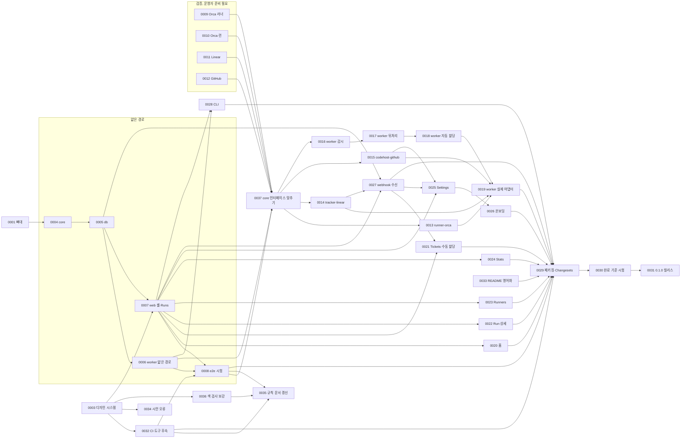

# 로컬 티켓

이 저장소는 트래커 없이 이 폴더의 파일로 일감을 관리한다. 파일 하나가 티켓 하나다.

- 파일 이름: `NNNN-slug.md`
- frontmatter: `status: todo | doing | done`, 선행 티켓은 `blocked_by`
- 용어는 루트의 `GLOSSARY.md`를 따른다.

## 순서도

1단계 스펙([`docs/spec/0001-phase-1.md`](../spec/0001-phase-1.md))을 쪼갠 티켓 0004~0037의 선행 관계다. 화살표는 `blocked_by`를 따른다(선행 → 후행). 0001~0003은 끝났다.

- 서로 선행 관계가 없는 티켓은 파일 소유가 겹치지 않아 함께 돌릴 수 있다. 패키지 단위로 나눴고, worker 티켓(0006, 0016~0019)은 모두 `apps/worker`를 고쳐 차례로 한다.
- web 티켓(0020~0027)은 0007 뒤에 서로 다른 라우트만 고치고, 앱 셸과 서버 설정은 0007이 맡는다. 예외는 둘이다. 0026은 루트 라우트(`__root.tsx`)에 온보딩으로 보내는 처리를 더하고, web 서버의 어댑터 생성 코드는 0027(tracker-linear)과 0025(codehost-github)가 만든다.
- 생성 파일 `routeTree.gen.ts`, 각 앱의 `package.json` 의존성, `pnpm-lock.yaml`은 함께 도는 티켓끼리 겹칠 수 있다. 병합할 때 다시 생성하거나 다시 설치해 맞춘다.
- 검증 결과에 따른 core 인터페이스 변경은 0037 하나로 모은다. 어댑터 티켓(0013~0015)은 `packages/core`를 고치지 않아 함께 돌 수 있다. 0037은 바뀐 인터페이스를 부르는 worker 코드도 고치므로, 다른 worker 티켓이 돌지 않는 0006·0008과 0016 사이에 둔다.
- 검증 티켓(0009~0012)과 0019·0030·0031은 운영자가 준비할 테스트 환경이나 계정이 필요하다. 필요한 것은 각 티켓에 적었다.
