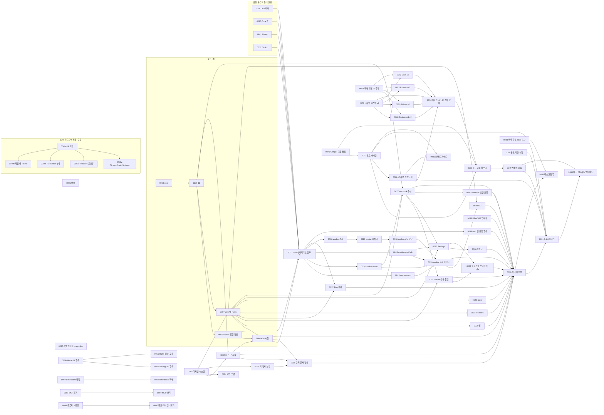

# 로컬 티켓

이 저장소는 트래커 없이 이 폴더의 파일로 일감을 관리한다. 파일 하나가 티켓 하나다.

- 파일 이름: `NNNN-slug.md`
- frontmatter: `status: todo | doing | done`, 선행 티켓은 `blocked_by`
- 용어는 루트의 `GLOSSARY.md`를 따른다.
- 오케스트레이션으로 이 저장소를 만들며 배운 점과 제품 반영 후보는 [`docs/research/0010-dogfooding-lessons.md`](../research/0010-dogfooding-lessons.md)에 모은다.

## 순서도

1단계 스펙([`docs/spec/0001-phase-1.md`](../spec/0001-phase-1.md))을 쪼갠 티켓 0004~0040과 그 뒤 티켓 0046~0093의 선행 관계다. 화살표는 `blocked_by`를 따른다(선행 → 후행). 0041~0045와 0050~0093 중 선행 관계가 없는 티켓은 순서도에 넣지 않았다. 0001~0003은 끝났다.

- 서로 선행 관계가 없는 티켓은 파일 소유가 겹치지 않아 함께 돌릴 수 있다. 패키지 단위로 나눴고, worker 티켓(0006, 0016~0019)은 모두 `apps/worker`를 고쳐 차례로 한다.
- web 티켓(0020~0027)은 0007 뒤에 서로 다른 라우트만 고치고, 앱 셸과 서버 설정은 0007이 맡는다. 예외는 둘이다. 0026은 루트 라우트(`__root.tsx`)에 온보딩으로 보내는 처리를 더하고, web 서버의 어댑터 생성 코드는 0027(tracker-linear)과 0025(codehost-github)가 만든다.
- 생성 파일 `routeTree.gen.ts`, 각 앱의 `package.json` 의존성, `pnpm-lock.yaml`은 함께 도는 티켓끼리 겹칠 수 있다. 병합할 때 다시 생성하거나 다시 설치해 맞춘다.
- 검증 결과에 따른 core 인터페이스 변경은 0037 하나로 모은다. 어댑터 티켓(0013~0015)은 `packages/core`를 고치지 않아 함께 돌 수 있다. 0037은 바뀐 인터페이스를 부르는 worker 코드도 고치므로, 다른 worker 티켓이 돌지 않는 0006·0008과 0016 사이에 둔다. core 열거값에 값을 더하면 web 코드와 메시지도 고치므로, 0037과 함께 도는 web 티켓은 병합할 때 새 값을 다시 맞춘다.
- **보류와 해제(운영자 지시 2026-11-18):** 0031(0.1.0 릴리스). 0029는 같은 날 운영자 결정으로 npm 패키지 대신 공개하지 않는 서버 배포물을 만드는 일로 바뀌어 보류를 풀었다. 0031은 그 뒤 운영자 결정으로 npm 없이 macOS 앱(dmg)만 공개하기로 바뀌었고(Linux 서버 배포물은 0.1.0에 올리지 않는다), 서명·공증은 `v*` 태그 push 때 CI에서 하기로 했으며, 같은 날 보류를 풀었다. 0030은 저장소에서 CLI로 띄워 시험했고(Q90) 0029를 기다리지 않는다. dmg 안에 0029의 서버 배포물이 들어가므로 0031은 0029에도 막혀 있다.
- 0046(데스크톱 앱)은 같은 날 운영자 지시로 보류를 풀었다. 0029의 배포물을 싣고 0048의 신원 확인 경로를 쓴다. 릴리스(자동 업데이트 피드, Releases 업로드, 태그, 서명·공증)는 빼고 0046의 「후속(릴리스 때)」에 두었다. 0031을 할 때 함께 본다. 그중 자동 업데이트는 0083으로 옮겼다.
- 0048(바깥 주소 설정, Host·Origin 검사, 신원 확인 경로, 0046 그릴링 2라운드 2026-11-18)은 선행 티켓이 없고 0046이 그 신원 확인 경로를 쓴다.
- 0049(리디자인 적용, 운영자 결정 2026-11-18, [ADR 0010](../adr/0010-ui-words-and-visual-rules.md))는 묶음 티켓이고 하위 티켓 0049a~0049e로 나눴다. 0049a(`packages/ui` 토큰·상태 알약·버튼·카드, 시간 표기 함수, 메시지 낱말)가 선행이고 끝났다. 0049b~e는 0049a 뒤에 서로 다른 라우트를 고쳐 함께 돌 수 있고, 셸과 겹치는 루트 레이아웃은 0049b가 맡는다. `packages/ui`와 web 화면·메시지를 두루 고쳐 다른 web 티켓과 함께 돌면 겹친다.
- 0047(개발 진입점, 운영자 요청 2026-11-18)은 선행 티켓이 없다. 루트 `pnpm dev`와 `demo/` 패키지만 더하고 제품 앱과 빌드 설정은 고치지 않는다.
- 0041~0045는 0030의 완료 기준 시험이 찾은 결함이다([research 0011](../research/0011-acceptance-run.md)). 서로 선행 관계가 없다. 0042·0043은 운영자 결정이 필요하다(각 티켓의 「운영자 결정 필요」).
- 0050~0057은 화면별 UI 리뷰 후속이다(2026-11-18). 화면마다 티켓 하나라 서로 다른 파일을 고쳐 함께 돌 수 있다. 예외로 0055와 0056은 0050이 고치는 `packages/ui`(`field.tsx`, `layout.tsx`)를 다시 고쳐 0050 뒤에 한다. 포커스를 잃는 같은 패턴(누른 요소가 다시 읽은 뒤 DOM에서 빠짐)이 0050·0051·0052·0054·0055에 있어, 먼저 끝난 티켓의 해법을 나머지가 따른다.
- 0059(결정, 문서)와 0060(화면 구현)은 Home을 Dashboard로 바꾸는 개편이다(운영자 결정 2026-11-18). 0060은 0059 뒤에 한다.
- 0058(web이 DB에 쓴 직후 worker 깨우기, 운영자 결정 2026-11-18)은 선행 티켓이 없다. `apps/worker` 루프와 `package.json`(zod), `apps/cli`의 `start`, web 서버 진입(`apps/web/src/server.ts`), `demo/`, `e2e/` 시험, ADR 0002, 루트 README를 고친다. 다른 worker 티켓이나 web 서버 진입을 고치는 티켓과 함께 돌면 겹친다.
- 0061(e2e 브라우저 시험 안정화, 2026-11-18)은 선행 티켓이 없다. `e2e/**`와 vitest 설정만 고친다. 0060은 0061이 머지될 때까지 `e2e/**`를 고치지 않는다.
- 0062(데스크톱 앱 서버 찾기 후속, 2026-11-18)는 선행 티켓이 없다. 0046의 화면 개편(#89) 독립 리뷰가 남긴 막지 않는 지적을 모았다. `apps/desktop`만 고친다.
- 0063~0067은 Dashboard 개편(0059~0061) 뒤 남은 후속이다(2026-11-18). 서로 선행 관계가 없다. 0064는 저장 형식을 바꾸는 one-way 변경이라 사람이 병합한다. 0066과 0063은 Dashboard 메시지·시험 파일이 겹칠 수 있어 함께 돌리면 병합할 때 맞춘다.
- 0068(결정, 문서) 뒤에 0069~0072(화면 넷)를 한다. 0069~0072는 서로 다른 화면이라 함께 돌 수 있다(운영자 결정 2026-11-18). 0066은 0069에 합쳐 끝냈고, 0067의 Stats 묶음 표 부분은 0072로 옮겼다. 0063은 `tickets.json`의 "손댈 일"을 고쳐 0070과 겹칠 수 있어, 함께 돌리면 병합할 때 0070의 필터 낱말(GLOSSARY Tickets 필터)에 맞춘다.
- 0073(디자인 시스템 v2: 글자·면 역할과 새 컴포넌트)은 0068과 함께, 0069~0072 앞에 한다. 0069~0072는 0073이 `packages/ui`에 더한 역할과 컴포넌트를 가져다 쓰기만 한다. 0074(디자인 시스템 사용을 검사로 강제)는 0069~0073 뒤에 한다.
- 0076~0079는 제품 이름을 Ganger로 바꾸는 브랜딩이다(운영자 결정 2026-11-18). 0076(결정) 뒤에 0077(로고·아이콘), 그 뒤에 0078(코드 이름 바꾸기)을 한다. 0078은 0074와 0077 뒤에 한다(거의 모든 파일을 고치고, README 머리에 0077의 원본을 쓴다). 0079(저장소 이름)는 0078 뒤에 운영자가 GitHub에서 이름을 바꾼 다음 한다. 0080(앱 화면 브랜드 색)은 0077 뒤에 하고, 0074와 같은 `packages/ui`를 고치므로 0074 전에 한다(0074가 0080을 기다린다). 0031(릴리스)은 0080도 기다리고, npm 없이 macOS dmg만 `v*` 태그 push 때 CI에서 서명·공증해 내며, 릴리스 스크립트와 워크플로는 0076~0079 뒤에 만든다.
- 0083(데스크톱 자동 업데이트)은 0031에서 0.1.0에 넣지 않기로 한 자동 업데이트다(운영자 결정 2026-11-18). 피드 주소가 저장소 주소에 달려 0079 뒤에, 0031의 릴리스 워크플로 위에 한다.
- 0081(브랜드 가이드, 운영자 요청 2026-11-18)은 0077·0080 뒤에 흩어진 브랜딩 규칙을 `packages/ui/brand/README.md` 한 장에 모은다. 문서만 고쳐 0074와 함께 돌 수 있다.
- 0084(서버가 도는 동안 맥이 잠들지 않게, 운영자와 정함 2026-11-19)는 선행 티켓이 없다. `apps/cli`의 `start`, web Settings(「설치 전체」의 잠자기), 데스크톱 시험, 루트 README를 고친다.
- 0086(러너의 공급자 사용량, 운영자와 정함 2026-11-19)은 선행 티켓이 없다. `packages/core`·`runner-orca`·`db`(one-way 마이그레이션, 사람이 병합)·`apps/worker`의 러너 점검, `packages/ui`(`UsageBar`, `size.usageColumn`), Runners 화면, Dashboard Runners 구역, 데모 시드를 고친다. Dashboard 부분은 0085(Dashboard Runners 칸)가 머지된 뒤에 했다.
- 0090(한도 러너 건너뛰기)은 0086 뒤에 한다. `packages/core` 할당·대기열, `packages/db`의 러너 스냅샷, `apps/worker` 대기열, web 대기 사유 문구와 Tickets 할당 대화상자, Dashboard 한도 문구를 고친다. 0088(MCP 읽기)과 함께 돌면 web 로더가 겹칠 수 있다.
- 0091(목록 화면 폭·시간 칸·고른 행, 운영자 결정 2026-11-19)은 선행 티켓이 없다. Dashboard·Runs·Tickets 화면과 `packages/ui`(`TimeSlot`·`RowActionSlot`, `Table`, 탭, `bgSelected`)를 고친다. 고른 행 모양은 `packages/ui` 한 곳이라 Runners 목록에도 함께 바뀐다. 0092(Runners)·0093(Stats)과 함께 돈다.
- 0085(Dashboard Runners를 칸으로, 운영자 결정 2026-11-19)는 선행 티켓이 없다. Dashboard Runners 구역, `packages/ui`의 `CapacityCells`, `/ds`를 고친다. 0086(공급자 사용량)과 함께 돌고, Runners 목록 화면은 0086이 고쳐 0085는 건드리지 않는다.
- 검증 티켓(0009~0012)과 0019·0030·0031은 운영자가 준비할 테스트 환경이나 계정이 필요하다. 필요한 것은 각 티켓에 적었다. 0009는 끝났다(7번은 1단계 이후).

## 운영자 준비 대기

검증 티켓에서 운영자가 준비해야 확인할 수 있는 항목이다. 번호는 스펙 10절의 번호다.

- research 0006 15절의 남은 확인: 비공개 테스트 저장소에서 fine-grained PAT로 CI 결과가 오는지. Q79로 CI 상태는 선택 표시라 설계를 막지 않는다.

0009의 7번(Linux 러너)은 1단계 이후로 미뤘다(Q82.17, 스펙 2절). 1단계에서는 Linux 테스트 러너를 준비하지 않는다.

## 운영자 답 대기

스펙 11절 열린 질문에 운영자가 답해야 끝낼 수 있는 티켓이다. 답이 나오기 전에는 그 부분만 빼고 진행하고, 티켓 본문에 적혀 있지 않아도 그 부분을 기본 동작으로 정하지 않는다. 질문 1~9는 운영자가 2026-11-17에 답했고(Q82.8~Q82.15, Q82.18·Q82.21·Q82.22) 스펙과 각 티켓에 반영했다. 지금 답을 기다리는 질문은 없다.

질문 10·11은 운영자가 답했고(Q86·Q87) 0037이 스펙 3절 2·3번·9절과 GLOSSARY, core 규칙에 반영했다. 아래 티켓 본문의 "질문 10·11의 답을 따르고, 답 전에는 정하지 않는다"는 이제 스펙의 그 문장을 따른다는 뜻이다.

- 질문 10(시작 명령이 실패한 런, Q86): 0013, 0016, 0037.
- 질문 11(GitHub 인증이 깨진 러너의 Queued 이유 문구, 새 할당, 수동 할당, Q87): 0020, 0021, 0022, 0037, 0038.
